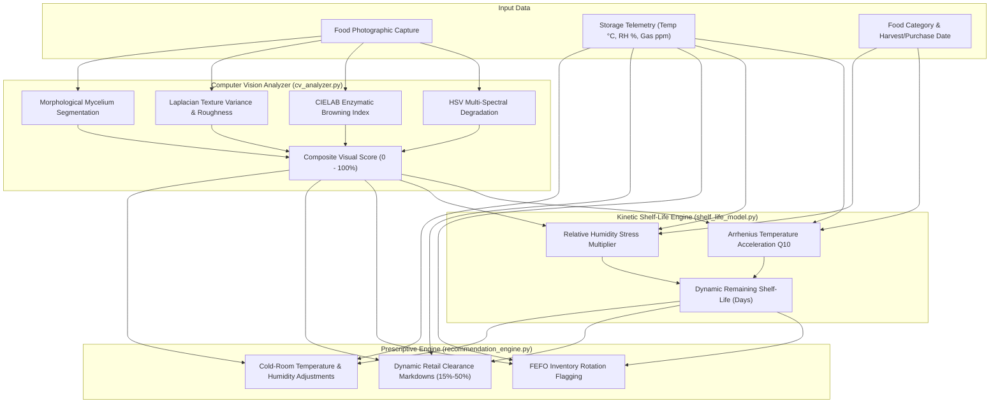

# Food Freshness Monitoring Platform —

[](https://fastapi.tiangolo.com)
[](https://www.mongodb.com)
[](https://python.org)
[](https://opencv.org)
[](https://www.docker.com)
[](https://www.chartjs.org)
[-brightgreen.svg)]()
[](https://opensource.org/licenses/MIT)

An enterprise-grade, cloud-ready **AI-Powered Food Freshness Monitoring Platform** engineered to prevent food waste across consumers, retail grocers, commercial restaurants, regional warehouses, and global cold-chains.

---

## Table of Contents

1. [Executive Overview](#1-executive-overview)
2. [Milestone 4 Deliverables & Accomplishments](#2-milestone-4-deliverables--accomplishments)
3. [Technology Stack](#3-technology-stack)
4. [Inference Engines & AI Architecture](#4-inference-engines--ai-architecture)
5. [Executive Analytics & Compliance Reporting](#5-executive-analytics--compliance-reporting)
6. [Project Directory Architecture](#6-project-directory-architecture)
7. [Installation & Local Setup](#7-installation--local-setup)
8. [Docker & Containerized Deployment](#8-docker--containerized-deployment)
9. [Automated Test Suite (100% Pass)](#9-automated-test-suite-100-pass)
10. [REST API Directory](#10-rest-api-directory)
11. [Default Seed Credentials & Roles](#11-default-seed-credentials--roles)
12. [Technical Documentation Index](#12-technical-documentation-index)

---

## 1. Executive Overview

Perishable supply chains lose billions annually due to rigid, static expiration date labels and delayed cold-chain visibility. The **Food Freshness Monitoring Platform** replaces guesswork with non-invasive AI diagnostics:

- **Computer Vision Quality Grading**: Analyzes uploaded food images for chromatic degradation (HSV/LAB), enzymatic browning, Laplacian texture wrinkling, and fungal mycelium colonies.
- **Biochemical Reaction Kinetics**: Models real-time shelf life using Arrhenius temperature acceleration ($Q_{10}$) and relative humidity stress factors.
- **Prescriptive Decision Engine**: Automates dynamic retail markdown clearance schedules (e.g. 20%–50% discounts) and FEFO (First-Expired, First-Out) warehouse rotation to prevent landfill waste.
- **Executive Analytics & Reporting**: Delivers interactive Chart.js visualizations, 11 dynamic database KPIs, CSV data streaming, and printable Quality Assurance Certificates.
- **Platform Governance & Security**: Dedicated Administrator Console managing user lifecycle, operational RBAC, storage safety tolerances, AI performance monitoring, and append-only audit trails.

---

## 2. Milestone 4 Deliverables & Accomplishments

- [x] **Project Audit & Gap Resolution**: Audited entire codebase and resolved all legacy placeholder stubs ([`docs/milestone4-audit.md`](docs/milestone4-audit.md)).
- [x] **Platform Administrator Console**: Redesigned and implemented the dedicated Platform Administrator Console as the platform-level system manager. Features 8 integrated governance modules: dynamic MongoDB Atlas KPIs, user search & filtering, role assignment with last-admin protection, soft activation/deactivation revocation, AI vision telemetry & error counters, global category storage tolerances CRUD, append-only security audit trail, live MongoDB Atlas ping & service probes, and runtime configuration ([`frontend/admin-dashboard.html`](frontend/admin-dashboard.html)).
- [x] **Dedicated Retailer Operations Hub**: Implemented complete 12-module Retailer Workspace with RBAC isolation, multi-tenant inventory scoping, non-negative stock adjustments, FEFO markdowns, AI scan card, storage compliance, and CSV export ([`frontend/retailer-dashboard.html`](frontend/retailer-dashboard.html)).
- [x] **Food Quality Inspector Hub**: Implemented dedicated 12-endpoint Quality Inspector workspace with image-based multi-spectral diagnostics, immutable AI traceability, human quality validation, shelf-life and storage condition auditing, alert workflows, quality analytics, and CSV streaming ([`frontend/dashboard-inspector.html`](frontend/dashboard-inspector.html)).
- [x] **Live Computer Vision Analyzer**: Implemented multi-spectral HSV/LAB color degradation, browning indices, Laplacian texture roughness, and mycelium segmentation ([`backend/app/ml/cv_analyzer.py`](backend/app/ml/cv_analyzer.py)).
- [x] **Arrhenius Shelf-Life Engine**: Implemented temperature-acceleration ($Q_{10}$) kinetic decay modeling with humidity stress multipliers ([`backend/app/ml/shelf_life_model.py`](backend/app/ml/shelf_life_model.py)).
- [x] **Prescriptive FEFO Engine**: Built automated retail markdown and cold-room correction matrix ([`backend/app/ml/recommendation_engine.py`](backend/app/ml/recommendation_engine.py)).
- [x] **Executive Analytics Dashboard**: Built multi-filter executive view featuring 11 dynamic MongoDB KPIs and 4 interactive Chart.js visualizations ([`frontend/executive-dashboard.html`](frontend/executive-dashboard.html)).
- [x] **Quality & Compliance Reports**: Built tabular audit trails, CSV export streaming, and printable Quality Assurance Certificates ([`frontend/reports.html`](frontend/reports.html)).
- [x] **Liveness & Readiness Probes**: Implemented production `/health` (MongoDB ping) and `/ready` (ML models & storage write check) endpoints.
- [x] **Production Docker Containerization**: Hardened `Dockerfile` with non-root user `appuser` (UID 10001), OpenCV dependencies, and `docker-compose.yml` multi-container specification.
- [x] **Comprehensive Test Suite**: Developed 13 dedicated test suites in `tests/` with **72 of 72 tests passing (100%)**.
- [x] **Complete Technical Documentation**: Delivered comprehensive architecture, database schema, API, ML model, testing, deployment, user manual, limitations, and final presentation slide deck in `docs/`.

---

## 3. Technology Stack

- **Frontend**: Native HTML5, Modern CSS3 (CSS Custom Properties, Grid/Flexbox), Vanilla JavaScript (ES6+), Chart.js 4.4, Fetch API with JWT Bearer Interceptor. Zero heavy frontend frameworks.
- **Backend**: Python 3.11 / 3.13, FastAPI 0.115, Uvicorn ASGI Server, Pydantic v2.
- **Machine Learning & Image Processing**: OpenCV (`cv2`), Pillow (`PIL`), NumPy, Scikit-learn.
- **Persistence**: MongoDB 7.0+ / MongoDB Atlas (Replica Set), PyMongo 4.x driver.
- **Security**: HMAC-SHA256 (`HS256`) JSON Web Tokens (`PyJWT`), Salted password hashing via `passlib` & `bcrypt`.
- **Containerization & Cloud**: Docker, Docker Compose, Azure Container Apps, AWS ECS Fargate.
- **Testing**: Pytest 9.1, HTTPX, FastAPI TestClient.

---

## 4. Inference Engines & AI Architecture



---

## 5. Executive Analytics & Compliance Reporting

### 5.1 Executive Analytics (`frontend/executive-dashboard.html`)
- **11 Real-Time KPIs**: Total items, total quantity, analyses run, fresh items, moderate items, spoiled items, average quality score, average shelf life, items approaching expiry, active alerts, and waste avoidance percentage.
- **4 Chart.js Visualizations**:
  1. *Freshness Distribution*: Segmented donut chart of stock quality.
  2. *Food Category Analysis*: Multi-category comparison of quality scores vs inventory count.
  3. *Shelf-Life Horizon Analysis*: Expiration risk distribution across 5 temporal buckets.
  4. *Storage Telemetry Trends*: Dual-axis time-series tracking ambient temperature and humidity.
- **Interactive Multi-Filtering**: Slice metrics dynamically by Date Range, Category, and Storage Bay.

### 5.2 Quality Reports & Certification (`frontend/reports.html`)
- **CSV Data Streaming**: Export formatted quality records for ERP or spreadsheet ingestion.
- **Quality Assurance Certificates**: Branded modal displaying verification IDs, laboratory indices, and storage directives, formatted for `@media print` physical or PDF output.

---

## 6. Project Directory Architecture

```text
Infosys Springboard/
├── backend/
│   ├── app/
│   │   ├── main.py                     # FastAPI application, route mounting, probes
│   │   ├── config.py                   # Environment settings & path resolution
│   │   ├── database.py                 # MongoDB Atlas connection & indexing
│   │   ├── seed.py                     # Database demo account and inventory seeding
│   │   ├── ml/                         # Machine learning & kinetic models
│   │   │   ├── cv_analyzer.py          # OpenCV multi-spectral degradation analyzer
│   │   │   ├── shelf_life_model.py     # Arrhenius kinetic shelf-life decay engine
│   │   │   ├── recommendation_engine.py# Prescriptive FEFO & markdown pricing engine
│   │   │   └── report_generator.py     # Compliance summaries, CSV & certificates
│   │   ├── models/                     # Data serializers & domain models
│   │   ├── routes/                     # Domain-specific REST API routers
│   │   │   ├── auth_routes.py          # /api/auth (Register, Login, Me)
│   │   │   ├── user_routes.py          # /api/users (Admin RBAC management)
│   │   │   ├── inventory_routes.py     # /api/inventory (CRUD, uploads, search)
│   │   │   ├── ai_routes.py            # /api/freshness, /api/shelf-life, /api/storage
│   │   │   ├── analytics_routes.py     # /api/analytics/executive
│   │   │   └── report_routes.py        # /api/reports (Summary, CSV, Certificate)
│   │   ├── schemas/                    # Pydantic v2 validation contracts
│   │   ├── services/                   # Business logic encapsulation
│   │   └── utils/                      # Security, JWT, RBAC dependencies
│   └── requirements.txt                # Python package specifications
│
├── frontend/                           # Native client application
│   ├── index.html                      # Landing portal
│   ├── login.html / register.html      # Authentication views
│   ├── dashboard.html                  # User inventory KPI dashboard
│   ├── inventory.html                  # Searchable, filterable food inventory
│   ├── add-food.html                   # Food intake & image upload view
│   ├── food-details.html               # Item inspector & live AI diagnostic card
│   ├── executive-dashboard.html        # Executive analytics with Chart.js
│   ├── reports.html                    # Quality reports & printable certificates
│   ├── profile.html                    # User account & role badge view
│   ├── css/                            # Shared modern styling stylesheets
│   └── js/                             # Modular Vanilla JavaScript controllers
│
├── docs/                               # Comprehensive Technical Documentation
│   ├── milestone4-audit.md             # Codebase audit & gap resolution report
│   ├── system-architecture.md          # Multi-tier system architecture
│   ├── database-schema.md              # MongoDB collections & ER diagram
│   ├── api-documentation.md            # Complete Swagger/REST API reference
│   ├── ai-model-documentation.md       # Computer Vision & Arrhenius kinetic math
│   ├── deployment-guide.md             # Docker, Azure Container Apps & AWS guide
│   ├── testing-guide.md                # Testing strategy & instructions
│   ├── test-report.md                  # Milestone 4 test execution report (34/34 pass)
│   ├── user-manual.md                  # Role-based user & operations guide
│   ├── known-limitations.md            # Real-world constraints & roadmap
│   └── final-presentation.md           # 13-Slide executive presentation deck
│
├── tests/                              # Pytest automated test suite (34 tests)
├── uploads/                            # Media storage for food inspection images
├── Dockerfile                          # Hardened non-root production container
├── docker-compose.yml                  # Multi-container local orchestration
├── .dockerignore                       # Container build exclusions
├── .env.example                        # Production environment configuration template
└── README.md                           # Master project guide
```

---

## 7. Installation & Local Setup

### 7.1 Clone and Setup Environment
```bash
# Clone the repository
git clone <repository-url>
cd "Infosys Springboard"

# Create and activate Python virtual environment
python -m venv .venv
source .venv/bin/activate       # On Linux / macOS
# or
.venv\Scripts\activate          # On Windows PowerShell
```

### 7.2 Install Dependencies
```bash
pip install --upgrade pip
pip install -r backend/requirements.txt
```

### 7.3 Configure Environment Variables
Copy `.env.example` to `.env`:
```bash
cp .env.example .env
```
Ensure `MONGO_URI`, `DATABASE_NAME`, and `JWT_SECRET` are defined.

### 7.4 Seed Initial Accounts & Inventory
```bash
python backend/app/seed.py
```

### 7.5 Launch Application Server
```bash
uvicorn backend.app.main:app --host 127.0.0.1 --port 8000 --reload
```
Access the application at `http://127.0.0.1:8000`.

---

## 8. Docker & Containerized Deployment

### 8.1 Single-Command Docker Compose Launch
```bash
docker compose up -d --build
```
This automatically builds the hardened application container (`food_freshness_app`), launches a MongoDB 7.0 container (`food_freshness_mongo`), configures persistent data volumes, and executes health probes.

### 8.2 Verify Container Probes
```bash
# Check container status
docker compose ps

# Test liveness probe
curl http://localhost:8000/health

# Test readiness probe
curl http://localhost:8000/ready
```

---

## 9. Automated Test Suite (100% Pass)

The project includes 13 dedicated test modules covering authentication, RBAC, inventory validation, image uploads, computer vision analysis, Arrhenius shelf-life kinetics, IoT telemetry, executive analytics, compliance reports, the dedicated Retailer Role, the Food Quality Inspector Role, and the Platform Administrator Role.

```bash
# Run the complete test suite
pytest tests/ -v
```

### Test Results Summary
```text
======================= 72 passed, 1 warning in 46.98s ========================
```
See the full verification matrix in [`docs/test-report.md`](docs/test-report.md).

---

## 10. REST API Directory

| Domain | Method | Endpoint | Description |
| :--- | :--- | :--- | :--- |
| **Auth** | `POST` | `/api/auth/register` | Register user account |
| **Auth** | `POST` | `/api/auth/login` | Authenticate and obtain JWT token |
| **Auth** | `POST` | `/api/auth/google` | Google OAuth token sign-in (auto-role containment) |
| **Auth** | `GET` | `/api/auth/me` | Current authenticated user identity |
| **Users** | `GET` | `/api/users` | List platform users (Admin only) |
| **Admin** | `GET` | `/api/admin/dashboard` | Platform overview KPIs, recent users & audit trail |
| **Admin** | `GET` | `/api/admin/users` | List, search (name/email) & filter (role/status) users |
| **Admin** | `GET` | `/api/admin/users/{id}` | Inspect detailed user profile, login & audit info |
| **Admin** | `PATCH` | `/api/admin/users/{id}/role` | Assign / change operational role (with sole admin check) |
| **Admin** | `PATCH` | `/api/admin/users/{id}/activate` | Reactivate previously deactivated user account |
| **Admin** | `PATCH` | `/api/admin/users/{id}/deactivate` | Suspend user account with reason (blocks login & APIs) |
| **Admin** | `GET` | `/api/admin/ai/statistics` | Prediction distributions, avg confidence, error counters |
| **Admin** | `GET` | `/api/admin/audit-logs` | Filterable append-only security audit trail |
| **Admin** | `GET` | `/api/admin/storage-rules` | List global category storage tolerances & zones |
| **Admin** | `POST` | `/api/admin/storage-rules` | Create storage rule with min <= max tolerance validation |
| **Admin** | `PUT` | `/api/admin/storage-rules/{id}` | Update existing storage tolerance rule |
| **Admin** | `DELETE`| `/api/admin/storage-rules/{id}` | Delete storage tolerance rule |
| **Admin** | `GET` | `/api/admin/system/health` | Live MongoDB Atlas ping latency & service probes |
| **Admin** | `GET` | `/api/admin/system/config` | View platform runtime configuration (secrets sanitized) |
| **Admin** | `PUT` | `/api/admin/system/config` | Update feature toggles, quarantine score & upload limits |
| **Admin** | `GET` | `/api/admin/reports/analytics` | Aggregated user, freshness & inventory analytics |
| **Admin** | `GET` | `/api/admin/reports/export-csv` | Stream downloadable platform users CSV export |
| **Inventory** | `POST` | `/api/inventory` | Create food inventory item |
| **Inventory** | `GET` | `/api/inventory` | List & filter food items |
| **Inventory** | `GET` | `/api/inventory/{id}` | Retrieve item details |
| **Inventory** | `PUT` | `/api/inventory/{id}` | Update item parameters |
| **Inventory** | `DELETE`| `/api/inventory/{id}` | Delete food item |
| **Inventory** | `POST` | `/api/inventory/upload-image` | Upload food inspection photo |
| **AI** | `POST` | `/api/freshness/analyze` | Execute OpenCV degradation analysis |
| **AI** | `POST` | `/api/shelf-life/predict` | Predict remaining days via Arrhenius |
| **AI** | `POST` | `/api/spoilage/detect` | Spoilage detection with gas telemetry |
| **AI** | `GET` | `/api/recommendations/{id}` | Prescriptive FEFO & markdown advice |
| **IoT** | `POST/GET`| `/api/storage/conditions` | Ingest / fetch storage telemetry |
| **Analytics** | `GET` | `/api/analytics/executive` | Dynamic KPIs & Chart.js datasets |
| **Reports** | `GET` | `/api/reports/summary` | Tabular batch compliance data |
| **Reports** | `GET` | `/api/reports/export-csv` | Stream downloadable CSV report |
| **Reports** | `GET` | `/api/reports/batch/{id}` | Quality Assurance Certificate payload |
| **Retailer** | `GET` | `/api/retailer/dashboard` | Retailer overview KPIs, priority action queue, recent items |
| **Retailer** | `GET/POST`| `/api/retailer/inventory` | Scoped product listing, search, multi-filter & product registration |
| **Retailer** | `GET/PUT/DEL`| `/api/retailer/inventory/{id}` | Scoped item detail inspection, editing, and deletion |
| **Retailer** | `PATCH`| `/api/retailer/inventory/{id}/stock`| Quantity adjustment ('set', 'add', 'deduct') with non-negative validation |
| **Retailer** | `PATCH`| `/api/retailer/inventory/{id}/archive`| Inactive product archival toggle |
| **Retailer** | `POST` | `/api/retailer/inventory/{id}/analyze`| Scoped image upload with OpenCV & Arrhenius AI analysis |
| **Retailer** | `GET` | `/api/retailer/expiry` | Expiry tracking: safe, approaching expiry, expired horizons |
| **Retailer** | `GET` | `/api/retailer/shelf-life` | Arrhenius temperature-accelerated shelf-life monitoring |
| **Retailer** | `GET` | `/api/retailer/alerts` | Spoilage & cold-chain temperature anomaly alerts |
| **Retailer** | `PATCH`| `/api/retailer/alerts/{id}/acknowledge`| Acknowledge alert with operational notes |
| **Retailer** | `GET` | `/api/retailer/storage` | Display case & chiller environmental compliance audit |
| **Retailer** | `GET` | `/api/retailer/waste-reduction` | FEFO stock markdown (30%, 50%) & donation candidate list |
| **Retailer** | `GET` | `/api/retailer/analytics` | 11 dynamic MongoDB KPIs and 4 Chart.js datasets |
| **Retailer** | `GET` | `/api/retailer/reports` | Tabular product audit records |
| **Retailer** | `GET` | `/api/retailer/reports/export-csv`| Stream authorized retailer CSV audit report |
| **Retailer** | `GET` | `/api/retailer/notifications`| Live operational event notification feed |
| **Retailer** | `PATCH`| `/api/retailer/notifications/{id}/read`| Mark single notification as read |
| **Retailer** | `PATCH`| `/api/retailer/notifications/read-all`| Mark all notifications as read |
| **Inspector** | `GET` | `/api/inspector/dashboard` | Inspector overview KPIs, recent inspections, critical alerts |
| **Inspector** | `GET/POST` | `/api/inspector/inspections` | Inspection list/filtering & multipart food photo submission |
| **Inspector** | `POST` | `/api/inspector/inspections/json` | JSON inspection submission |
| **Inspector** | `GET` | `/api/inspector/inspections/{id}` | Detailed inspection record and AI scorecard |
| **Inspector** | `PATCH` | `/api/inspector/inspections/{id}/review` | Record human review (Confirmed/Flagged/Requires Further Inspection) |
| **Inspector** | `PATCH` | `/api/inspector/inspections/{id}/flag` | Flag defective item and dispatch quality alert |
| **Inspector** | `GET` | `/api/inspector/inspection-history` | Filterable inspection audit trail |
| **Inspector** | `GET` | `/api/inspector/quality-analytics` | Quality analytics KPIs, freshness distribution, defect trends |
| **Inspector** | `GET` | `/api/inspector/alerts` | Quality alerts queue (Investigate, Flag, Resolve) |
| **Inspector** | `PATCH` | `/api/inspector/alerts/{id}/resolve` | Resolve alert with corrective action notes |
| **Inspector** | `GET` | `/api/inspector/storage-review` | Category-specific storage tolerance compliance audit |
| **Inspector** | `GET` | `/api/inspector/reports/export-csv` | Stream downloadable inspection audit CSV |
| **Probes** | `GET` | `/health` & `/ready` | Liveness and readiness container probes |

---

## 11. Default Seed Credentials & Roles

The database seeder provisions pre-configured accounts representing each key role:

| Role | Email | Password |
| :--- | :--- | :--- |
| **Admin** | `admin@foodfresh.com` | `AdminPass123!` |
| **Food Quality Inspector** | `inspector@foodfresh.com` | `InspectorPass123!` |
| **Retailer** | `retailer@foodfresh.com` | `RetailerPass123!` |
| **Warehouse Manager** | `warehouse@foodfresh.com` | `WarehousePass123!` |
| **Restaurant** | `restaurant@foodfresh.com` | `RestaurantPass123!` |
| **Consumer** | `consumer@foodfresh.com` | `ConsumerPass123!` |

---

## 12. Technical Documentation Index

For exhaustive technical references, inspect the files in `docs/`:

- [System Architecture Specification](docs/system-architecture.md)
- [Database Schema & ER Diagrams](docs/database-schema.md)
- [Complete REST API Reference](docs/api-documentation.md)
- [AI & Reaction Kinetics Model Documentation](docs/ai-model-documentation.md)
- [Cloud & Container Deployment Guide](docs/deployment-guide.md)
- [Comprehensive Testing Guide](docs/testing-guide.md)
- [Milestone 4 Test Execution Report](docs/test-report.md)
- [User & Operations Manual](docs/user-manual.md)
- [Known Limitations & Strategic Roadmap](docs/known-limitations.md)
- [Executive Presentation & Demonstration Deck](docs/final-presentation.md)
- [Milestone 4 Codebase Audit & Gap Analysis](docs/milestone4-audit.md)
