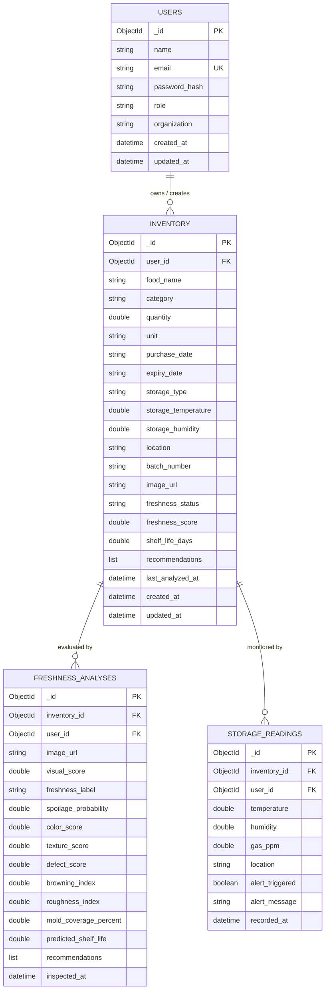

# Database Schema Documentation

## Database Overview
- **Database System**: MongoDB 7.0+ / MongoDB Atlas (Distributed Replica Set)
- **Database Name**: `food_freshness_db`
- **Driver**: PyMongo 4.x
- **Wire Protocol**: MongoDB Wire Protocol with mandatory TLS/SSL encryption

---

## Entity Relationship Overview



---

## 1. Collection: `users`

Stores platform user accounts, authentication hashes, and authorized role designations.

### Field Specifications

| Field | Data Type | Constraint | Description |
| :--- | :--- | :--- | :--- |
| `_id` | `ObjectId` | Primary Key | Unique document identifier generated by MongoDB. |
| `name` | `String` | Required, 2-100 chars | User's full display name or enterprise entity name. |
| `email` | `String` | Required, Unique, Lowercase | Unique contact and login email address. |
| `password_hash` | `String` | Required | Salted bcrypt hash string (never stored as plain text). |
| `role` | `String` | Required | One of: `Consumer`, `Retailer`, `Restaurant`, `Warehouse Manager`, `Food Manufacturer`, `Supply Chain Operator`, `Admin`. |
| `organization` | `String` | Optional, default null | Corporate or warehouse division name. |
| `is_active` | `Boolean` | Default: `true` | Account activation status. |
| `created_at` | `DateTime` | Required, UTC | Record insertion timestamp. |
| `updated_at` | `DateTime` | Required, UTC | Last profile modification timestamp. |

### Indexes
- `{"email": 1}` — Unique index enforcing singleton email registrations across the platform.
- `{"role": 1}` — Accelerates administrative role filtering and audits.

### Example Document
```json
{
  "_id": { "$oid": "670c538a0f8b1e42701e1a01" },
  "name": "Alex Mercer",
  "email": "retailer@foodfresh.com",
  "password_hash": "$2b$12$K89e9Y7j8r0L0Kk9z2W3e.m7p3V0O1q4X9Z8U7T6S5R4Q3P2O1N0M",
  "role": "Retailer",
  "organization": "FreshGrocers Metro",
  "is_active": true,
  "created_at": { "$date": "2026-10-14T08:30:00.000Z" },
  "updated_at": { "$date": "2026-10-14T08:30:00.000Z" }
}
```

---

## 2. Collection: `inventory`

Maintains active food stock records, storage parameters, AI freshness status, and remaining shelf life.

### Field Specifications

| Field | Data Type | Constraint | Description |
| :--- | :--- | :--- | :--- |
| `_id` | `ObjectId` | Primary Key | Unique inventory record identifier. |
| `user_id` | `ObjectId` | Required, Foreign Key | Reference to owning user in `users._id`. |
| `food_name` | `String` | Required, 1-100 chars | Common name or trade name of the food item. |
| `category` | `String` | Required | Category: `Fruits`, `Vegetables`, `Dairy`, `Meat`, `Fish`, `Grains`, `Bakery`, `Packaged Food`, `Other`. |
| `quantity` | `Double` | Required, > 0 | Numerical quantity of food in inventory. |
| `unit` | `String` | Required | Unit of measurement (`kg`, `g`, `lbs`, `liters`, `pieces`, `cartons`). |
| `purchase_date` | `String` | Format: `YYYY-MM-DD` | Date when item was procured or harvested. |
| `expiry_date` | `String` | Format: `YYYY-MM-DD` | Manufacturer or anticipated expiration date. |
| `storage_type` | `String` | Required | Storage method: `Refrigerated`, `Frozen`, `Room Temperature`, `Pantry`, `Dry Storage`, `Cold Storage`, `Controlled Atmosphere`. |
| `storage_temperature`| `Double` | Optional (°C) | Current or nominal storage temperature. |
| `storage_humidity` | `Double` | Optional (% RH, 0-100) | Current or nominal relative humidity. |
| `location` | `String` | Optional | Specific storage location, bin, shelf, or warehouse zone. |
| `batch_number` | `String` | Optional | Lot or batch identification code. |
| `image_url` | `String` | Optional | Path to uploaded product inspection photo. |
| `freshness_status` | `String` | Default: "Not Analyzed" | Status: `Not Analyzed`, `Fresh`, `Moderate`, `Expiring Soon`, `Spoiled`. |
| `freshness_score` | `Double` | Optional (0.0 - 100.0) | Composite quality score calculated by AI model. |
| `shelf_life_days` | `Double` | Optional | Remaining shelf-life predicted by Arrhenius model. |
| `recommendations` | `Array[String]` | Optional | Prescriptive actions generated by the decision engine. |
| `last_analyzed_at` | `DateTime` | Optional, UTC | Timestamp of most recent quality scan. |
| `created_at` | `DateTime` | Required, UTC | Record insertion timestamp. |
| `updated_at` | `DateTime` | Required, UTC | Record last update timestamp. |

### Indexes
- `{"user_id": 1}` — Scopes inventory listings to the authenticated user.
- `{"category": 1}` — Supports fast category filtering.
- `{"expiry_date": 1}` — Optimizes FEFO sorting and expiring-soon queries.
- `{"freshness_status": 1}` — Accelerates freshness distribution queries.
- `{"user_id": 1, "category": 1, "freshness_status": 1}` — Compound index for executive analytics aggregation pipeline.

### Example Document
```json
{
  "_id": { "$oid": "670c541b0f8b1e42701e1a05" },
  "user_id": { "$oid": "670c538a0f8b1e42701e1a01" },
  "food_name": "Organic Strawberries",
  "category": "Fruits",
  "quantity": 12.0,
  "unit": "kg",
  "purchase_date": "2026-10-15",
  "expiry_date": "2026-10-22",
  "storage_type": "Refrigerated",
  "storage_temperature": 3.5,
  "storage_humidity": 90.0,
  "location": "Cold Room A - Bay 4",
  "batch_number": "STRAW-OCT-2026-44",
  "image_url": "/uploads/food_images/strawberries_batch44.jpg",
  "freshness_status": "Fresh",
  "freshness_score": 91.5,
  "shelf_life_days": 5.2,
  "recommendations": [
    "Maintain cold chain below 4.0°C to inhibit Botrytis mold formation.",
    "Prioritize distribution within 5 days according to FEFO protocol."
  ],
  "last_analyzed_at": { "$date": "2026-10-15T10:15:30.000Z" },
  "created_at": { "$date": "2026-10-15T09:00:00.000Z" },
  "updated_at": { "$date": "2026-10-15T10:15:30.000Z" }
}
```

---

## 3. Collection: `freshness_analyses`

Stores comprehensive Computer Vision inspection outputs, visual degradation indices, and model diagnostics.

### Field Specifications

| Field | Data Type | Constraint | Description |
| :--- | :--- | :--- | :--- |
| `_id` | `ObjectId` | Primary Key | Unique analysis record identifier. |
| `inventory_id` | `ObjectId` | Required, Foreign Key | Reference to `inventory._id`. |
| `user_id` | `ObjectId` | Required, Foreign Key | Reference to `users._id`. |
| `image_url` | `String` | Required | Source image processed by CV analyzer. |
| `visual_score` | `Double` | 0.0 - 100.0 | Overall visual freshness score. |
| `freshness_label` | `String` | Required | Categorical classification: `Fresh`, `Moderate`, `Spoiled`. |
| `spoilage_probability`| `Double` | 0.0 - 1.0 | Estimated probability of active microbial spoilage. |
| `color_score` | `Double` | 0.0 - 100.0 | HSV/LAB multi-spectral color degradation score. |
| `texture_score` | `Double` | 0.0 - 100.0 | Laplacian variance & texture smoothness score. |
| `defect_score` | `Double` | 0.0 - 100.0 | Surface browning and bruising penalty score. |
| `browning_index` | `Double` | 0.0 - 100.0 | Ratio of enzymatically browned surface pixels. |
| `roughness_index` | `Double` | >= 0.0 | Laplacian edge density representing surface shriveling. |
| `mold_coverage_percent`| `Double`| 0.0 - 100.0 | Surface area percentage infected by mycelium. |
| `predicted_shelf_life` | `Double`| Days | Arrhenius predicted remaining shelf life. |
| `recommendations` | `Array[String]` | List of prescriptive operational actions. |
| `inspected_at` | `DateTime` | UTC | Timestamp when inference executed. |

### Indexes
- `{"inventory_id": 1}` — Speeds up item-specific inspection history retrieval.
- `{"inspected_at": -1}` — Optimizes historical trend reporting.

---

## 4. Collection: `storage_readings`

Maintains time-series telemetry recorded by IoT environmental sensors and manual loggers.

### Field Specifications

| Field | Data Type | Constraint | Description |
| :--- | :--- | :--- | :--- |
| `_id` | `ObjectId` | Primary Key | Unique telemetry event identifier. |
| `inventory_id` | `ObjectId` | Required, Foreign Key | Reference to `inventory._id`. |
| `user_id` | `ObjectId` | Required, Foreign Key | Reference to `users._id`. |
| `temperature` | `Double` | Required (°C) | Ambient temperature reading. |
| `humidity` | `Double` | Required (% RH) | Relative humidity sensor reading. |
| `gas_ppm` | `Double` | Optional (ppm) | VOC or ethylene gas sensor reading. |
| `location` | `String` | Optional | Cold room or storage bay identifier. |
| `alert_triggered` | `Boolean` | Default: `false` | Indicates whether threshold was breached. |
| `alert_message` | `String` | Optional | Human-readable alert description. |
| `recorded_at` | `DateTime` | Required, UTC | Observation timestamp. |

### Indexes
- `{"inventory_id": 1, "recorded_at": -1}` — Optimizes timeseries chart generation for storage trends.
- `{"alert_triggered": 1}` — Accelerates active storage alert aggregation queries.
