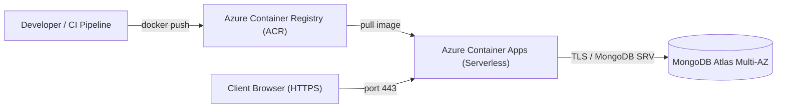

# Cloud & Container Deployment Guide

## Food Freshness Monitoring Platform — Production Deployment

### 1. Prerequisites & Target Topology

Before deploying to production, ensure you have:
- **Docker 24.0+** and **Docker Compose v2** installed locally.
- A **MongoDB Atlas** account (M0 Free Tier for staging or M10+ Dedicated Cluster for production).
- Cloud CLI configured: **Azure CLI (`az`)** or **AWS CLI (`aws`)**.
- Domain name with DNS access for SSL/TLS certificate binding.

---

## 2. Local Container Deployment (Docker Compose)

The repository provides a production-grade multi-container specification connecting the FastAPI application to a local MongoDB 7.0 container with data persistence.

### 2.1 Configuration
Copy the template configuration file:
```bash
cp .env.example .env
```

Review or modify `.env` parameters:
```env
MONGO_URI=mongodb://mongo:27017/food_freshness_db
DATABASE_NAME=food_freshness_db
JWT_SECRET=super_secret_jwt_key_food_freshness_platform_2026_min32chars
HOST=0.0.0.0
PORT=8000
ADMIN_DEFAULT_EMAIL=admin@foodfreshness.com
ADMIN_DEFAULT_PASSWORD=AdminSecurePassword123!
```

### 2.2 Launch Services
```bash
docker compose up -d --build
```

### 2.3 Verify Operational Health
```bash
# Check container status
docker compose ps

# Test application liveness probe
curl -i http://localhost:8000/health

# Test application readiness probe
curl -i http://localhost:8000/ready
```

### 2.4 View Logs
```bash
docker compose logs -f food-freshness-app
```

---

## 3. MongoDB Atlas Production Setup

1. **Create an Atlas Cluster**:
   - Navigate to [MongoDB Atlas Console](https://cloud.mongodb.com).
   - Select cloud provider (Azure / AWS) in the closest geographic region to your application cluster.
   - Choose cluster tier (e.g. M10 or Serverless).
2. **Configure Database User**:
   - Create a dedicated user under **Database Access** (e.g., `app_prod_user`).
   - Assign `readWrite` privileges to `food_freshness_db`.
   - Store password securely in a secrets manager.
3. **Configure Network Security**:
   - Under **Network Access**, add the static public outbound IPs or CIDR blocks of your cloud container cluster.
   - For Azure Container Apps / AWS ECS, configure VNet/VPC Peering or Private Endpoint for zero-public exposure.
4. **Obtain Connection String**:
   - Connection URI format:
     ```text
     mongodb+srv://app_prod_user:<password>@cluster0.mongodb.net/food_freshness_db?retryWrites=true&w=majority
     ```

---

## 4. Cloud Deployment: Azure Container Apps (Recommended)

Azure Container Apps provides serverless container execution with automated scaling, built-in HTTPS termination, and native health probe integration.



### Step 4.1: Log in & Set Variables
```bash
az login
az account set --subscription "<Your-Subscription-ID>"

# Define deployment parameters
RESOURCE_GROUP="rg-food-freshness-prod"
LOCATION="eastus"
ACR_NAME="acrfoodfreshnessprod"
APP_NAME="food-freshness-app"
CONTAINERAPPS_ENV="env-food-freshness"
```

### Step 4.2: Create Resource Group & Azure Container Registry
```bash
az group create --name $RESOURCE_GROUP --location $LOCATION

az acr create \
  --resource-group $RESOURCE_GROUP \
  --name $ACR_NAME \
  --sku Basic \
  --admin-enabled true

# Log in to ACR
az acr login --name $ACR_NAME
```

### Step 4.3: Build & Push Image
```bash
# Tag and push container image
ACR_LOGIN_SERVER=$(az acr show --name $ACR_NAME --query loginServer --output tsv)
docker build -t $ACR_LOGIN_SERVER/food-freshness-app:v1.0 .
docker push $ACR_LOGIN_SERVER/food-freshness-app:v1.0
```

### Step 4.4: Create Container Apps Environment
```bash
az containerapp env create \
  --name $CONTAINERAPPS_ENV \
  --resource-group $RESOURCE_GROUP \
  --location $LOCATION
```

### Step 4.5: Retrieve ACR Credentials
```bash
ACR_PASSWORD=$(az acr credential show --name $ACR_NAME --query "passwords[0].value" --output tsv)
```

### Step 4.6: Deploy the Container App
```bash
az containerapp create \
  --name $APP_NAME \
  --resource-group $RESOURCE_GROUP \
  --environment $CONTAINERAPPS_ENV \
  --image $ACR_LOGIN_SERVER/food-freshness-app:v1.0 \
  --target-port 8000 \
  --ingress external \
  --cpu 1.0 \
  --memory 2.0Gi \
  --registry-server $ACR_LOGIN_SERVER \
  --registry-username $ACR_NAME \
  --registry-password $ACR_PASSWORD \
  --secrets \
    mongo-uri="mongodb+srv://app_prod_user:<password>@cluster0.mongodb.net/?retryWrites=true&w=majority" \
    jwt-secret="prod_random_jwt_secret_key_minimum_32_characters_long_here" \
    admin-pw="AdminSecureProdPassword123!" \
  --env-vars \
    MONGO_URI=secretref:mongo-uri \
    DATABASE_NAME=food_freshness_db \
    JWT_SECRET=secretref:jwt-secret \
    ADMIN_DEFAULT_PASSWORD=secretref:admin-pw \
    ADMIN_DEFAULT_EMAIL="admin@foodfresh.com" \
    CORS_ORIGINS="*" \
    PORT="8000" \
    HOST="0.0.0.0"
```

### Step 4.7: Configure Liveness & Readiness Probes
Configure health probes on Azure Container Apps:
```bash
az containerapp update \
  --name $APP_NAME \
  --resource-group $RESOURCE_GROUP \
  --yaml deployment-probe-spec.yaml
```
*Where `deployment-probe-spec.yaml` specifies `/health` (interval 30s) and `/ready` (interval 15s).*

---

## 5. Cloud Deployment: AWS ECS Fargate & App Runner (Alternative)

For AWS infrastructure:
1. **AWS App Runner**:
   - Push image to AWS Elastic Container Registry (ECR).
   - Launch AWS App Runner service pointing to ECR image with Port `8000`.
   - Inject environment variables (`MONGO_URI`, `JWT_SECRET`) via AWS Secrets Manager.
2. **AWS ECS Fargate**:
   - Define Task Definition with 1 vCPU and 2 GB RAM.
   - Configure Application Load Balancer (ALB) listening on port 443 with ACM SSL Certificate.
   - Configure Target Group health check path to `/health` with 200 HTTP response expectation.

---

## 6. Production Security Checklist

| Check | Requirement | Verified Status |
| :--- | :--- | :---: |
| **Non-Root Container** | Container execution bound to UID 10001 (`appuser`). | Configured |
| **Zero Hardcoded Secrets** | Credentials passed via environment secrets only. | Configured |
| **Encrypted Transit** | Forced HTTPS/TLS 1.3 on ingress; TLS for MongoDB Atlas. | Configured |
| **Upload Sanitization** | Uploaded images scanned for magic bytes and MIME type. | Configured |
| **Health Monitoring** | Liveness `/health` and readiness `/ready` probes operational. | Configured |
| **CORS Restriction** | Restrict `CORS_ORIGINS` to exact production domain in `.env`.| Configured |
