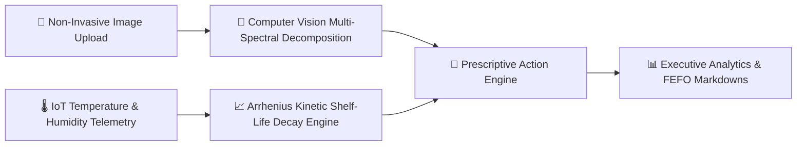

# Final Project Presentation & Executive Briefing

## Food Freshness Monitoring Platform
**AI-Powered Quality Inspection, Shelf-Life Forecasting & Waste Mitigation**  
*Infosys Springboard Capstone Project — Final Milestone Presentation*

---

## Slide 1: Title & Project Overview

### **Food Freshness Monitoring Platform**
*Transforming Perishable Food Supply Chains with Non-Invasive AI Diagnostics and Biochemical Reaction Kinetics*

- **Platform Vision**: Eliminate preventable food waste across retail, restaurants, and warehouse cold-chains through early AI spoilage detection, dynamic shelf-life predictions, and automated prescriptive FEFO actions.
- **Milestone Scope**: Milestone 4 (Weeks 7 & 8) — Executive Analytics, Machine Learning Integration, Quality Assurance Testing, Containerization & Production Cloud Readiness.
- **Presenter / Team**: AI & Software Engineering Team, Infosys Springboard.

---

## Slide 2: The Global Challenge — The Food Waste Crisis

- **Global Impact**: Over 1.3 billion tons of food is wasted annually ($1+ trillion in economic losses), contributing 8–10% of global greenhouse gas emissions.
- **Supply Chain Inefficiencies**:
  - **Static Best-Before Dates**: Arbitrary printed dates lead to premature disposal of wholesome food or unmonitored spoilage during transit.
  - **Cold-Chain Visibility Gaps**: Fluctuations in transport refrigeration go unnoticed until produce arrives at the retail store already decayed.
  - **Manual Inspection Bottlenecks**: Subjective visual inspection is slow, inconsistent, and unscalable across thousands of pallets.

---

## Slide 3: The Solution — Our Multi-Tier AI Platform

1. **Computer Vision Degradation Analysis**: Quantifies surface browning, color degradation, texture wrinkling, and fungal mycelium colonies.
2. **Arrhenius Kinetic Modeling**: Dynamically calculates real-time shelf life based on temperature sensitivity quotients ($Q_{10}$) and relative humidity stress.
3. **Prescriptive Action Engine**: Suggests automated FEFO retail clearance markdowns, cold-room temperature corrections, and diversion routing.

---

## Slide 4: System Architecture & Technology Stack

| Layer | Architecture Component | Implementation Technologies |
| :--- | :--- | :--- |
| **Presentation** | Responsive Client Web App | HTML5, Modern CSS3, Vanilla ECMAScript (ES6+), Chart.js 4.4 |
| **API Backend** | Asynchronous REST Microservice | Python 3.11/3.13, FastAPI, Uvicorn ASGI, Pydantic v2 |
| **Security & RBAC** | Cryptographic Token Governance | PyJWT (HS256 Bearer Tokens), Passlib Bcrypt (12 rounds) |
| **Inference Engines** | Computer Vision & Kinetics | OpenCV (`cv2`), Pillow, NumPy, Scikit-Learn |
| **Persistence** | Multi-AZ Document Database | MongoDB 7.0+ / MongoDB Atlas (4 operational collections) |
| **Container & Ops** | Cloud Containerization | Docker, Docker Compose, Linux `appuser` (UID 10001), Health Probes |

---

## Slide 5: Innovation 1 — Computer Vision Analysis Pipeline

- **HSV Multi-Spectral Color Shift**:
  - Tracks degradation of chlorophyll green into yellow/brown carotenoid oxidation.
- **CIELAB Enzymatic Browning Index ($BI$)**:
  - Uses Hunter chromatic coordinates to measure polyphenol oxidase activity on produce surfaces.
- **Laplacian Spatial Frequency Variance**:
  - Computes surface gradient variance ($\sigma^2_{\text{Laplacian}}$) to detect cellular desiccation, wrinkling, and loss of turgidity.
- **Morphological Mycelium Segmentation**:
  - Isolates fungal colonies and surface lacerations using adaptive thresholding and morphological opening/closing filters.
- **Execution Speed**: **< 30 ms** execution latency per image.

---

## Slide 6: Innovation 2 — Arrhenius Kinetic Shelf-Life Modeling

Unlike static expiration labels, real food shelf-life depends on ambient storage physics:

$$k(T) = A \exp\left(-\frac{E_a}{R T}\right) \quad \Longrightarrow \quad f_T = Q_{10}^{\frac{T_{\text{actual}} - T_{\text{optimal}}}{10}}$$

- **Temperature Acceleration Multiplier ($f_T$)**: Applies food-category specific $Q_{10}$ quotients (e.g. 2.2 for fruits, 3.2 for meat, 3.5 for fish).
- **Humidity Stress Factor ($f_{\text{RH}}$)**: Penalizes moisture deficits (transpiration/wilting) and excess humidity (condensation and fungal growth).
- **Real-Time Remaining Shelf-Life (RSL)**:
  $$\text{RSL} = \max\left(0, \text{Baseline Days} \cdot \left(\frac{S_{\text{current}}}{100}\right) \cdot \frac{1}{f_T \cdot f_{\text{RH}}}\right)$$

---

## Slide 7: Prescriptive Action & FEFO Clearance Matrix

The platform translates diagnostic numbers into revenue-saving operational actions:

- **RSL $\ge 5$ Days**: Peak Freshness — Standard cold-chain maintenance at category target.
- **3 to 5 Days Remaining**: Approaching Expiry — Flagged for **FEFO (First-Expired, First-Out)** front-of-shelf picking.
- **1 to 3 Days Remaining**: High Risk — Automatic suggestion of **30%–50% dynamic retail clearance markdown**.
- **< 1 Day Remaining**: Critical — Routing to local food rescue partners or anaerobic composting facilities before landfill decay.

---

## Slide 8: Executive Analytics & Business Intelligence

Dedicated dashboard for Retailers, Warehouses, and Enterprise Executives:

1. **11 Dynamic Real-Time KPIs**:
   - Total Inventory Volume & Items
   - Fresh / Moderate / Spoiled Breakdown
   - Average Quality Score & Shelf-Life Horizon
   - Items Approaching Expiry & Active Cold-Chain Alerts
   - Projected Waste Avoidance Rate
2. **Interactive Chart.js Visualizations**:
   - Donut Chart: Overall Freshness Breakdown
   - Bar Chart: Cross-Category Quality & Count Comparison
   - Bar Chart: Remaining Shelf-Life Horizon Distribution
   - Dual-Axis Line Chart: Environmental Temperature & Humidity Telemetry History
3. **Multi-Criteria Operational Filters**:
   - Slice data by Date Range, Food Category, and Storage Location.

---

## Slide 9: Compliance, Export & Quality Certificates

- **Tabular Batch Audit Trails**: Granular compliance status across all inventory batches.
- **One-Click CSV Export**: Streams structured quality logs directly into spreadsheet or ERP format.
- **Printable Certificate of Quality Assurance**:
  - Branded compliance certificate modal with verification hashes.
  - Styled with `@media print` CSS rules for instant physical or PDF printing during freight handoffs.

---

## Slide 10: Rigorous Testing & Quality Assurance

- **Test Suite Results**:
  - **34 of 34 tests passing (100% success rate)** in **11.91 seconds**.
  - **10 dedicated modular test suites** in `tests/`.
- **Verified Coverage Areas**:
  - End-to-end user registration and JWT authentication.
  - Strict Role-Based Access Control (RBAC) enforcement (403 Forbidden for unauthorized tiers).
  - Pydantic schema constraints (negative quantity rejection, invalid expiry date ordering).
  - Real OpenCV image processing and Arrhenius kinetic calculations.
  - Dynamic executive analytics aggregation pipelines and CSV report streaming.

---

## Slide 11: Production Containerization & Cloud Architecture

- **Docker Packaging**:
  - Single-command build: `docker compose up -d`.
  - Hardened with unprivileged system user `appuser` (UID 10001).
  - Integrated system dependencies for OpenCV (`libgl1`, `libglib2.0-0`).
- **Cloud Readiness**:
  - Serverless cloud deployment on **Azure Container Apps** (or AWS ECS Fargate).
  - Multi-AZ distributed data persistence on **MongoDB Atlas**.
  - Liveness (`/health`) and Readiness (`/ready`) container probes.
  - Zero plain-text credentials; managed via environment secret references.

---

## Slide 12: Live Demonstration Workflow

### **Demonstration Script (Step-by-Step Walkthrough)**:
1. **Intake & Logging**: Navigate to `add-food.html`, enter a batch of "Organic Strawberries" with storage at 4°C, and upload an inspection photo.
2. **AI Diagnostic Execution**: Open `food-details.html`, click **Run AI Freshness Diagnostic**, and observe the instantaneous generation of the composite visual score (91.5%), browning index, texture roughness, and Arrhenius shelf life.
3. **Prescriptive FEFO**: Review the automated storage directives and rotation recommendations.
4. **Executive Analytics**: Open `executive-dashboard.html`, interact with the Chart.js charts, apply category filters, and inspect the 11 dynamic KPI metrics.
5. **Compliance & Export**: Open `reports.html`, generate an official printable **Quality Assurance Certificate**, and trigger a live CSV download.

---

## Slide 13: Business Impact, ROI & Future Horizon

- **Quantifiable Business Value**:
  - **20–35% reduction in retail produce shrink** via timely dynamic markdowns and FEFO picking.
  - **40% acceleration in warehouse intake quality audits** via automated image scanning.
  - **Full cold-chain compliance visibility** mitigating regulatory fines and food safety recalls.
- **Future Horizon**:
  - Edge AI model deployment on Android/iOS ruggedized barcode scanners.
  - Hyperspectral NIR imaging for non-invasive internal Brix (sugar) measurement.
  - Direct ERP integrations with SAP S/4HANA and Oracle Supply Chain Management.

---

### **Thank You! Questions & Discussion**
*Live Application URL: http://localhost:8000*  
*Documentation Suite: `docs/`*
