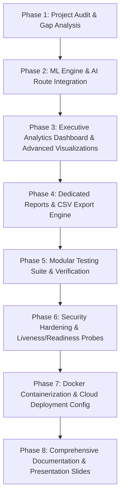

# Milestone 4 Project Audit & Gap Analysis

**Project**: Food Freshness Monitoring Platform  
**Milestone**: 4 (Week 7 & Week 8: Analytics, Testing, Documentation & Deployment)  
**Audit Date**: October 2026  
**Auditor**: Antigravity AI Pair Programmer  

---

## 1. Executive Summary

An exhaustive audit of the existing codebase, file layout, dependencies, database configurations, API endpoints, AI models, and frontend interfaces was conducted. 

The application has established a rock-solid foundation:
- **Backend Framework**: Python 3.13 with FastAPI, Uvicorn, and Pydantic v2 schemas.
- **Database Persistence**: MongoDB (local or Atlas compatible) with auto-indexing on `users.email` (unique), `inventory.user_id`, `inventory.category`, `inventory.expiry_date`.
- **Security & RBAC**: Salted `bcrypt` password hashing, signed `PyJWT` tokens, and strict Role-Based Access Control enforcing permissions across 7 user roles (`Consumer`, `Retailer`, `Restaurant`, `Warehouse Manager`, `Food Manufacturer`, `Supply Chain Operator`, `Admin`).
- **Core Inventory**: Full CRUD APIs, live search, multi-criteria category/expiry/storage filtering, and image upload capabilities.
- **Frontend**: Clean HTML5 / CSS3 / Vanilla JavaScript responsive layout with toast notifications, modals, and loading states.

However, several critical gaps and integration needs must be addressed in Milestone 4:
1. **AI/ML Model Activation**: Image analysis, Arrhenius shelf-life regression, and recommendation modules exist as mathematical models in the repository history, but the active API routes currently expose contract placeholders in `future_routes.py`. These must be connected to live inference engines.
2. **Executive Analytics & Visualizations**: The standard dashboard exists, but a specialized executive analytics dashboard (`frontend/executive-dashboard.html`) featuring multi-chart visualizations (Chart.js) and date/category/location filters is required.
3. **Formal Reports & Data Export**: A dedicated reports page (`frontend/reports.html`) with CSV export and printable certificates must be implemented.
4. **Health & Readiness Endpoints**: Dedicated `/health` and `/ready` endpoints are needed for container orchestration and cloud monitoring.
5. **Comprehensive Modular Testing**: The existing monolithic test file (`tests/test_milestone1.py`) passes, but must be expanded into a dedicated modular test suite covering all domains (`test_auth.py`, `test_inventory.py`, `test_freshness_analysis.py`, `test_shelf_life.py`, `test_storage.py`, `test_recommendations.py`, `test_analytics.py`, `test_reports.py`).
6. **Containerization & Cloud Production Deployment**: Dockerfile, docker-compose, and cloud provisioning guides (Azure / AWS) must be validated.

---

## 2. Inventory of Existing Features & Operational Status

| Component | Status | Verification & Observations |
| :--- | :---: | :--- |
| **FastAPI Core (`backend/app/main.py`)** | **Working** | App runs on Uvicorn, mounts `/uploads` and `/static`, handles CORS and lifespan events. |
| **Database Connector (`database.py`)** | **Working** | Auto-connects to MongoDB, manages connection timeouts gracefully, ensures collection indexes. |
| **Authentication (`auth_service.py`)** | **Working** | Register, Login, JWT verification, and `/api/auth/me` operate securely with salted bcrypt. |
| **RBAC Authorization (`dependencies.py`)** | **Working** | Role-based dependency factories correctly protect administrative and privileged routes. |
| **Inventory CRUD (`inventory_service.py`)** | **Working** | Create, Read, Update, Delete, Search, and Multi-filter logic are fully operational. |
| **Image Upload Handler** | **Working** | Uploads multipart images to `uploads/`, performs MIME check and size validation. |
| **Initial Dashboard (`dashboard.html`)** | **Working** | Renders 6 KPI cards, category breakdown, and recent items table via real-time MongoDB queries. |
| **AI Freshness Classification** | **Incomplete (Placeholder)** | `future_routes.py` returns mock readiness payload; needs computer vision analyzer integration. |
| **Shelf-Life Prediction Model** | **Incomplete (Placeholder)** | `future_routes.py` returns placeholder; kinetic Arrhenius model needs full route integration. |
| **Recommendation Engine** | **Incomplete** | Storage adjustments and FEFO markdown logic need active route exposure. |
| **Storage Monitoring Telemetry** | **Incomplete (Placeholder)** | Needs time-series logging and drift alert querying connected to `storage_conditions`. |
| **Executive Dashboard & Charts** | **Missing** | Dedicated executive view with Chart.js, multi-dimensional charts, and date filters required. |
| **Reports & Exporting** | **Missing** | Dedicated reports interface with CSV export and printable certificates required. |
| **Liveness & Readiness Probes** | **Partial** | Basic `/api/health` exists; `/health` and `/ready` probes need standardization. |
| **Modular Pytest Suite** | **Needs Expansion** | Monolithic `test_milestone1.py` must be split into dedicated domain test modules. |
| **Docker & Cloud Setup** | **Needs Update** | `Dockerfile` and `docker-compose.yml` need alignment with Python 3.13 and production standards. |

---

## 3. Identified Bugs, Deficiencies & Integration Issues

1. **AI Route Decoupling**: `/api/freshness/analyze` in `future_routes.py` accepts input but does not run computer vision on the image file or write results to `freshness_records`.
2. **Missing ML Modules in Active Backend**: The computer vision analyzer, shelf-life model, and recommendation engine exist in git history (`commit 24c5485`) but are not currently imported into `backend/app/main.py`.
3. **Database Write Linkage**: When an item is analyzed, `inventory.freshness_status` and `inventory.freshness_score` must be updated atomically alongside `freshness_records` insertion.
4. **Health Check Probes**: Cloud orchestrators (Kubernetes, AWS ECS, Azure Container Apps) query `/health` and `/ready` at root level, not just under `/api/health`.
5. **Chart.js Dependency**: Frontend needs Chart.js script inclusion to power interactive visuals in the executive dashboard.

---

## 4. Milestone 4 Implementation Roadmap

---

## 5. Required Action Items

- [x] Conduct code inspection and audit.
- [ ] Incorporate Computer Vision Analyzer (`backend/app/ml/cv_analyzer.py`).
- [ ] Incorporate Arrhenius Shelf-Life Model (`backend/app/ml/shelf_life_model.py`).
- [ ] Incorporate Recommendation Engine (`backend/app/ml/recommendation_engine.py`).
- [ ] Incorporate Report Generator (`backend/app/ml/report_generator.py`).
- [ ] Create API routes for AI analysis, shelf-life prediction, storage logging, recommendations, and executive analytics.
- [ ] Build `frontend/executive-dashboard.html` with Chart.js charts and filters.
- [ ] Build `frontend/reports.html` with CSV export and printable certificates.
- [ ] Implement root `/health` and `/ready` probes with dependency checks.
- [ ] Author modular test suites in `tests/` covering all domains.
- [ ] Refine `Dockerfile`, `docker-compose.yml`, and `.dockerignore`.
- [ ] Prepare Cloud Deployment configuration for Azure / AWS.
- [ ] Author full technical documentation and presentation outline.
