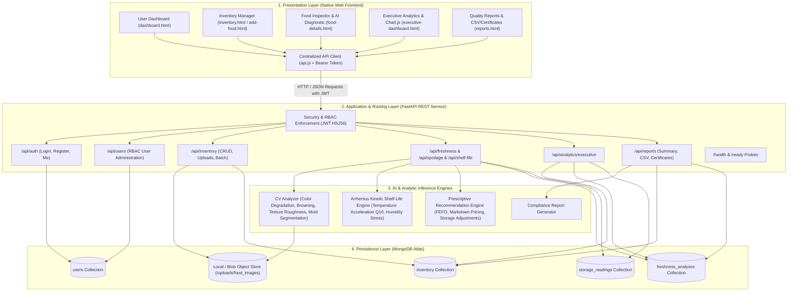
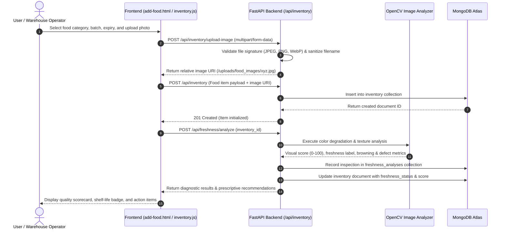
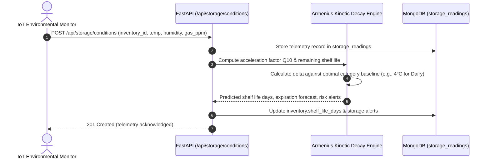
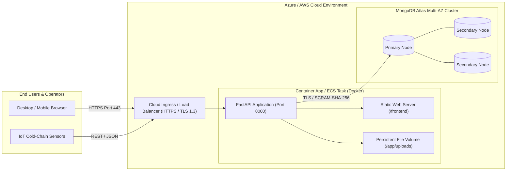

# System Architecture Documentation

## Food Freshness Monitoring Platform — Milestone 4 Architecture

### 1. Architectural Overview

The **Food Freshness Monitoring Platform** is a scalable, cloud-ready, enterprise web platform engineered to automate food quality inspection, predict shelf life, mitigate supply chain waste, and deliver executive-grade visibility.

The architecture is organized into four decoupled tiers:
1. **Presentation Layer (Frontend)**: Native HTML5/CSS3 and Vanilla JavaScript (ES6+) with Chart.js for data visualization. Zero heavyweight framework dependencies.
2. **Application & API Layer (FastAPI REST Server)**: Asynchronous Python 3.11/3.13 backend using FastAPI, Pydantic data schemas, Uvicorn ASGI server, and PyJWT token security.
3. **AI & Analytic Inference Engine**: Computer Vision multi-spectral degradation pipeline (OpenCV / PIL / NumPy), Arrhenius kinetic shelf-life decay model, and prescriptive FEFO / markdown recommendation engine.
4. **Persistence & Telemetry Layer (MongoDB Atlas)**: Document database storing platform users, food inventories, multi-parameter freshness analyses, and IoT telemetry streams.

---

### 2. Layered Responsibilities & Technology Stack

| Layer | Technologies | Responsibilities |
| :--- | :--- | :--- |
| **Presentation** | HTML5, CSS3, Vanilla JavaScript, Chart.js 4.4, Lucide Icons | Responsive UI rendering, state management, interactive charts, real-time client-side validation, JWT persistence in `localStorage`, export triggers. |
| **API & Routing** | FastAPI 0.115, Uvicorn 0.34, Pydantic v2 | Contract validation, route dispatching, dependency injection, CORS handling, JWT token decoding, role-based route guardrails. |
| **Business Logic** | Python 3.11+, PyJWT, Passlib/Bcrypt | User credential encryption, multi-tenant inventory scoping, batch aggregations, operational metric computations. |
| **Machine Learning** | OpenCV (`cv2`), Pillow (`PIL`), NumPy, Scikit-learn | Multi-spectral image color degradation, surface browning indices, Laplacian texture roughness, Arrhenius kinetic modeling, FEFO discount modeling. |
| **Persistence** | MongoDB 7.0/8.0+ or MongoDB Atlas Cluster | BSON document store, indexing (email, user_id, category, expiry_date, item_id), aggregation pipelines for analytics KPIs. |
| **Container & Ops** | Docker, Docker Compose, Linux base (Debian/Alpine) | Containerized packaging, non-root system isolation, health probes (`/health`, `/ready`), cloud portability (Azure Container Apps, AWS ECS). |

---

### 3. Comprehensive Data Flow Architecture

#### A. Food Intake & Initial Quality Inspection Workflow

#### B. Arrhenius Shelf-Life Decay & IoT Telemetry Flow

---

### 4. Role-Based Access Control (RBAC) Matrix

The system implements strict permission scoping based on user roles:

| Capability / Resource | Consumer | Retailer | Restaurant | Warehouse Manager | Food Manufacturer | Supply Chain Operator | Admin |
| :--- | :---: | :---: | :---: | :---: | :---: | :---: | :---: |
| **Personal Dashboard** | Yes | Yes | Yes | Yes | Yes | Yes | Yes |
| **Manage Own Inventory** | Yes | Yes | Yes | Yes | Yes | Yes | Yes |
| **Upload Food Photos** | Yes | Yes | Yes | Yes | Yes | Yes | Yes |
| **Trigger AI Freshness Diagnostic** | Yes | Yes | Yes | Yes | Yes | Yes | Yes |
| **View Prescriptive Recommendations** | Yes | Yes | Yes | Yes | Yes | Yes | Yes |
| **View Cross-User Enterprise Inventory** | No | No | No | Yes | Yes | Yes | Yes |
| **Access Executive Analytics Dashboard** | No | Yes | Yes | Yes | Yes | Yes | Yes |
| **Generate Quality & Compliance Reports** | No | Yes | Yes | Yes | Yes | Yes | Yes |
| **Export Official Batch Certificates** | No | Yes | Yes | Yes | Yes | Yes | Yes |
| **User Administration & Role Assignment**| No | No | No | No | No | No | Yes |

---

### 5. Deployment & Cloud Architecture

---

### 6. Security & Hardening Architecture

1. **Authentication & Token Cryptography**:
   - JWT tokens signed with HMAC-SHA256 (`HS256`) using a minimum 32-character secret key.
   - User passwords salted and hashed with `bcrypt` (12 rounds) via `passlib`.
   - Token expiration set to configurable durations (default: 24 hours).
2. **Container Security**:
   - Container runs as unprivileged user `appuser` (UID 10001) to prevent root breakouts.
   - Clean `.dockerignore` file prevents leakage of `.env`, `.git`, or temporary artifacts into container images.
3. **Database Security**:
   - Mandatory TLS encryption in transit for MongoDB Atlas connections.
   - IP access control whitelist configured on Atlas cluster.
   - No database credentials committed in source code; managed via container environment variables.
4. **Resilience & Probes**:
   - `/health` endpoint executes live MongoDB ping verifying database connectivity.
   - `/ready` endpoint verifies AI inference pipelines and upload directory write readiness.
