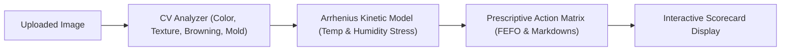

# User & Operational Manual

## Food Freshness Monitoring Platform — Operations Guide

### 1. Introduction

The **Food Freshness Monitoring Platform** empowers household consumers, retail grocery managers, restaurant operators, and cold-chain warehouse supervisors to monitor food freshness, prevent premature spoilage, track remaining shelf life, and comply with safety standards.

---

## 2. Getting Started

### 2.1 Accessing the Platform
Open your browser and navigate to:
```text
http://localhost:8000
```
*(or the cloud URL assigned to your enterprise deployment).*

### 2.2 Account Registration
1. Click **Register** on the navigation bar.
2. Enter your **Full Name**, **Email Address**, and choose a secure password (minimum 8 characters with at least one number and special character).
3. Select your operational **Role**:
   - `Consumer`: Individual / Household food management.
   - `Retailer`: Grocery store managers, front-of-shelf inventory.
   - `Restaurant`: Commercial kitchen and food service inventory.
   - `Warehouse Manager`: Cold storage and logistics hubs.
   - `Food Manufacturer`: Packaged food and processing plants.
   - `Supply Chain Operator`: In-transit distribution managers.
4. Click **Create Account** to finalize registration.

### 2.3 Logging In
1. Navigate to **Login**.
2. Enter your registered email and password.
3. Upon successful validation, the system issues a secure JWT bearer token and redirects you to your operational dashboard.

---

## 3. Inventory Management Workflows

### 3.1 Adding a Food Item
1. From the navigation header, select **Add Food**.
2. Provide core product details:
   - **Food Name**: e.g., "Organic Gala Apples".
   - **Category**: Select from *Fruits, Vegetables, Dairy, Meat, Fish, Grains, Bakery, Packaged Food, Other*.
   - **Quantity & Unit**: e.g., `15.0` `kg`.
   - **Purchase / Harvest Date**: Date the product arrived.
   - **Anticipated Expiration Date**: Manufacturer label or estimated expiry.
3. Configure **Storage Parameters**:
   - **Storage Type**: *Refrigerated, Frozen, Room Temperature, Pantry, Dry Storage, Cold Storage*.
   - **Storage Temperature (°C)**: Measured ambient temperature (e.g., `4.0`).
   - **Storage Humidity (% RH)**: Measured relative humidity (e.g., `65.0`).
   - **Storage Location**: e.g., "Cold Room B - Shelf 3".
   - **Batch / Lot Number**: Traceability identifier (e.g., `LOT-2026-10A`).
4. Attach an **Inspection Photo**:
   - Click the upload area or drag-and-drop a clear, well-lit photo of the food surface.
   - Supported formats: `.jpg`, `.png`, `.webp` (up to 10 MB).
5. Click **Save Food Item**.

---

## 4. AI Freshness & Quality Diagnostics

### 4.1 Running an AI Quality Scan
1. Open **Inventory** from the navigation bar.
2. Click on the food item card or row to open **Food Details**.
3. Under the **AI Freshness Assessment** card, click **Run AI Freshness Diagnostic**.
4. The backend will synchronously run the computer vision and kinetic decay engines.



### 4.2 Interpreting the AI Scorecard
- **Composite Freshness Score (0–100%)**:
  - `75% - 100% (Green)`: **Fresh**. Peak cellular integrity and organoleptic quality.
  - `50% - 74% (Yellow)`: **Moderate Freshness**. Senescence initiated; prioritize consumption or retail rotation.
  - `< 50% (Red)`: **Spoiled / High Risk**. Microbial proliferation or cellular breakdown detected.
- **Enzymatic Browning Index**: Identifies polyphenol oxidase activity on produce surfaces.
- **Laplacian Texture Roughness**: Measures surface wrinkling and cellular turgidity loss.
- **Predicted Remaining Shelf Life**: Dynamic prediction calculated using Arrhenius temperature kinetics ($Q_{10}$).

---

## 5. Executive Analytics Dashboard

Authorized roles (`Retailer`, `Warehouse Manager`, `Admin`, etc.) can access executive-grade business intelligence.

1. Click **Executive Analytics** in the top navigation.
2. Review the **11 Dynamic KPI Cards**:
   - *Total Food Inventory*, *Total Quantity*, *Total AI Analyses*, *Fresh Items*, *Moderate Items*, *Spoiled / High-Risk Items*, *Average Quality Score*, *Average Remaining Shelf Life*, *Items Approaching Expiry*, *Active Storage Alerts*, and *Waste Avoidance Rate*.
3. Explore the **Interactive Chart.js Visualizations**:
   - **Freshness Distribution**: Donut chart visualizing quality distribution across all stock.
   - **Food Category Analysis**: Bar chart comparing quality scores and volume by category.
   - **Shelf-Life Horizon Analysis**: Bar chart segmenting remaining shelf-life buckets (0–2 days, 3–5 days, etc.).
   - **Storage Telemetry Trends**: Dual-axis line chart illustrating ambient temperature and relative humidity over time.
4. **Filtering**:
   - Filter by **Date Range**, **Category**, or **Storage Location**.
   - Click **Apply Filters** or **Refresh** to re-aggregate live database metrics.

---

## 6. Compliance, Reports & Exporting

### 6.1 Quality & Compliance Reports
1. Navigate to **Reports** from the top bar.
2. View the tabulated inventory health audit with Batch Numbers, Category, Expiry, Quality Score, Spoilage Risk, and Compliance Status.

### 6.2 Exporting Data (CSV)
- Click **Export CSV** at the top right of the reports page.
- The browser downloads a clean, timestamped `.csv` file formatted for Microsoft Excel, Google Sheets, or ERP ingestors.

### 6.3 Printable Quality Assurance Certificates
1. In the Reports table, click **Certificate** on any analyzed batch.
2. An official, branded **Certificate of Quality Assurance** modal opens containing:
   - Certificate Verification ID
   - Batch & Product Specifications
   - Laboratory & Vision Inspection Indices
   - Prescriptive Cold-Chain Directives
3. Click **Print Certificate** to open the browser print dialog formatted with clean `@media print` CSS rules (no headers/footers or buttons).

---

## 7. Role-Based Administration (Admins Only)

1. Administrators can view the registered users directory at `/api/users`.
2. Enterprise admins can audit platform accounts, manage warehouse locations, and enforce system security policies.

---

## 8. Retailer Workspace & Store Operations Hub

Retailers, supermarket floor managers, and food outlet staff have a dedicated operational workspace (`retailer-dashboard.html`). When a user with the `Retailer` role logs in, they are immediately routed to this specialized hub.

### 8.1 Accessing the Retailer Hub
- **Direct URL**: `http://localhost:8000/retailer-dashboard.html`
- **Demo Retailer Credentials**: `retailer@foodfresh.com` / `RetailerPass123!`
- **Navigation Bar**: Accessible via the **Retailer Hub** navigation link for authorized users.

### 8.2 Top-Level KPI Dashboard
The retailer header displays 5 live operational metrics aggregated in real time from MongoDB:
- **Total Products**: Active stock lines under management.
- **Total Units**: Cumulative physical inventory quantity.
- **Expiring Soon**: Items requiring rotation or clearance within 3 days.
- **Active Alerts**: Unresolved spoilage or temperature anomaly notifications.
- **Waste Risk Items**: High-risk stock candidates for clearance discounts or food rescue donation.

### 8.3 Priority Action Queue & Recent Inventory
- **Priority Action Queue**: Instantly highlights urgent items (expired produce, spoilage indicators, or critically low shelf life) with recommended actions.
- **Recent Inventory**: Quick view of recently modified or analyzed food items with quick stock adjustment triggers.

### 8.4 Inventory & Stock Count Management
- **Search & Filters**: Multi-attribute filtering by product name, food category, freshness grade, and expiry horizon.
- **Add Product Modal**: Register new retail inventory with batch numbers, display zone, storage temperature, humidity, and low-stock replenishment alert thresholds.
- **Stock Adjustment Modal**: Modify stock counts via `set` (recount), `add` (delivery intake), or `deduct` (sales/spoilage write-off). The system rejects negative inventory counts with `422 Unprocessable Content` and appends an immutable audit log to `stock_history`.
- **Product Archival**: Retire inactive products without deleting historical sales and quality records.

### 8.5 On-Demand AI Freshness Scanning
1. Select an inventory product from the dropdown in the **AI Freshness Scan** module.
2. Drag and drop or browse for an inspection image (`.jpg`, `.png`, `.webp`).
3. Click **Analyze Freshness**.
4. The system executes the OpenCV multi-feature engine and kinetic shelf-life predictor, displaying:
   - Freshness Grade (`Fresh`, `Expiring Soon`, `Spoiled`) and Score (0-100%).
   - Organoleptic features: enzymatic browning index, surface texture roughness, and spoilage indicators.
   - Dynamic Arrhenius shelf-life calculation taking current display case temperature into account.
   - Persists the diagnostic to the database and raises automated alerts if spoilage is detected.

### 8.6 Dynamic Waste Reduction & Clearance Markdown (FEFO)
In compliance with food rescue standards and First-Expired, First-Out (FEFO) principles:
- **Urgent Removal**: Products that are expired or spoiled are flagged for immediate clearance.
- **50% Clearance Markdown**: Products with $\le 1$ day of shelf life remaining are automatically queued for 50% discount promotional stickers.
- **30% Clearance Markdown**: Products with $\le 3$ days of shelf life remaining are queued for 30% discount.
- **Donation Candidates**: Safe products approaching expiry with quality score $> 60\%$ are flagged for local food bank rescue donation.

### 8.7 Storage Case Telemetry & Compliance
- Monitors display cases, walk-in coolers, and bakery counters against optimal food science parameters.
- Immediately flags temperature spikes or humidity deficits with corrective recommendations.

### 8.8 Retail Analytics & Reports Export
- **Interactive Visualizations**: Donut chart of stock freshness distribution, category quantity breakdown, expiry horizon timeline, and stock level vs replenishment threshold comparison.
- **CSV Data Export**: One-click download of the complete retail inventory audit spreadsheet (`.csv`) for accounting, restocking, and compliance audits.
- **Operational Notifications Feed**: Live feed of inventory updates, low stock warnings, and scan completion badges with mark-as-read controls.

---

## 9. Food Quality Inspector Workspace & Auditing Guide

The **Food Quality Inspector** role is an authorized quality-assurance and compliance tier designed for food safety auditors, internal supermarket QA specialists, and agricultural intake inspectors (`dashboard-inspector.html`).

### 9.1 Accessing the Inspector Hub
- **Direct URL**: `http://localhost:8000/dashboard-inspector.html`
- **Demo Inspector Credentials**: `inspector@foodfresh.com` / `InspectorPass123!`
- **Navigation Bar**: Accessible via the **Inspector Hub** link in the global topbar.

### 9.2 Image-Based Inspection Workflow
1. Navigate to the **Image Inspection** tab.
2. Enter product specifications: *Product Name*, *Category*, *Batch Code*, *Storage Location*, *Ambient Temperature (°C)*, and *Humidity (%RH)*.
3. Attach an inspection photo by dragging and dropping into the dropzone or browsing from disk.
4. Click **Run AI Freshness Diagnostic & Save**.
5. The system saves the image, extracts multi-spectral features using OpenCV, runs Arrhenius temperature kinetics, audits environmental tolerances, and immediately renders the **Quality Assessment Scorecard**.

### 9.3 Quality Assessment & AI Result Validation
The diagnostic scorecard renders:
- **Composite Quality Score (0–100%)**
- **AI Classification**: `Fresh`, `Moderately Fresh`, `Spoiled`
- **Confidence Score (%)**
- **Predicted Shelf Life (Days)** based on observed temperature
- **Spoilage Risk**: `Low`, `Medium`, `High`, `Critical`
- **Visual Defect Segmentation**: Enzymatic browning, mycelial mold growth percentage, bruising, and surface wrinkling.
- **Human Decision Buttons**:
  - `Confirm Review`: Accepts AI findings for distribution.
  - `Requires Further Inspection`: Flags item for secondary lab testing.
  - `Flag Product`: Directs immediate quarantine.

> [!IMPORTANT]
> **Data Integrity Guarantee**: In compliance with regulatory standards, the platform never modifies or overwrites the original AI prediction. The inspector's validation decision, comments, and adjusted shelf life are persisted in an independent `inspector_review` audit log.

### 9.4 Storage Condition Reference Review Tool
1. Switch to the **Storage Condition Review** tab.
2. Select any food category (e.g., Dairy, Meat, Fruits).
3. Input observed storage conditions (e.g., Temperature: `+8.0°C`, Humidity: `65%`).
4. Click **Audit Storage Tolerances**.
5. The system compares the input against standard food science thresholds and displays violations, permissible ranges, and corrective action advice.

### 9.5 Quality Analytics & Trend Visualizations
1. Navigate to **Quality Analytics** tab.
2. Review the 4 dynamic Chart.js charts:
   - **Freshness Classification Distribution**: Donut chart of Fresh, Moderately Fresh, and Spoiled proportions.
   - **Quality Score Trends**: Timeline of average daily quality scores.
   - **Spoilage & Flagged Frequency**: Comparative bar chart of spoiled items and inspector flags.
   - **Inspection Velocity**: Daily throughput of completed food quality inspections.

### 9.6 Quality Alerts & Resolution
1. View active alerts in the **Quality Alerts** tab.
2. For each alert, review the product, severity badge (`Low`, `Medium`, `High`, `Critical`), and inspection ID.
3. Click **Resolve** to open the resolution dialog, specify corrective actions taken (e.g., "Stock condemned and removed from chiller"), and close the alert.

### 9.7 Inspection Audit Trail & CSV Export
- Multi-parameter filtering in **Inspection History** by Category, Freshness Grade, Review Status, and Date Range.
- Click **Export Inspection Log (CSV)** to stream a formal Quality Assurance Inspection Log spreadsheet (.csv) for ERP integration.


