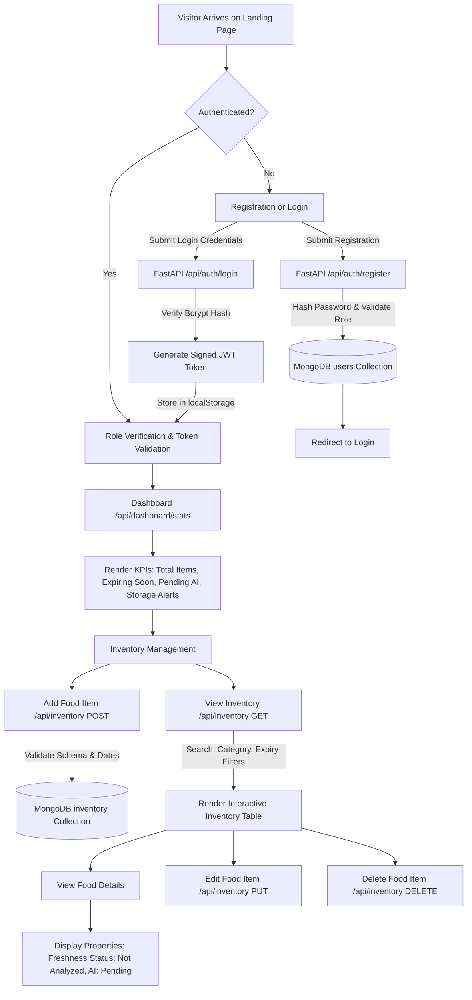
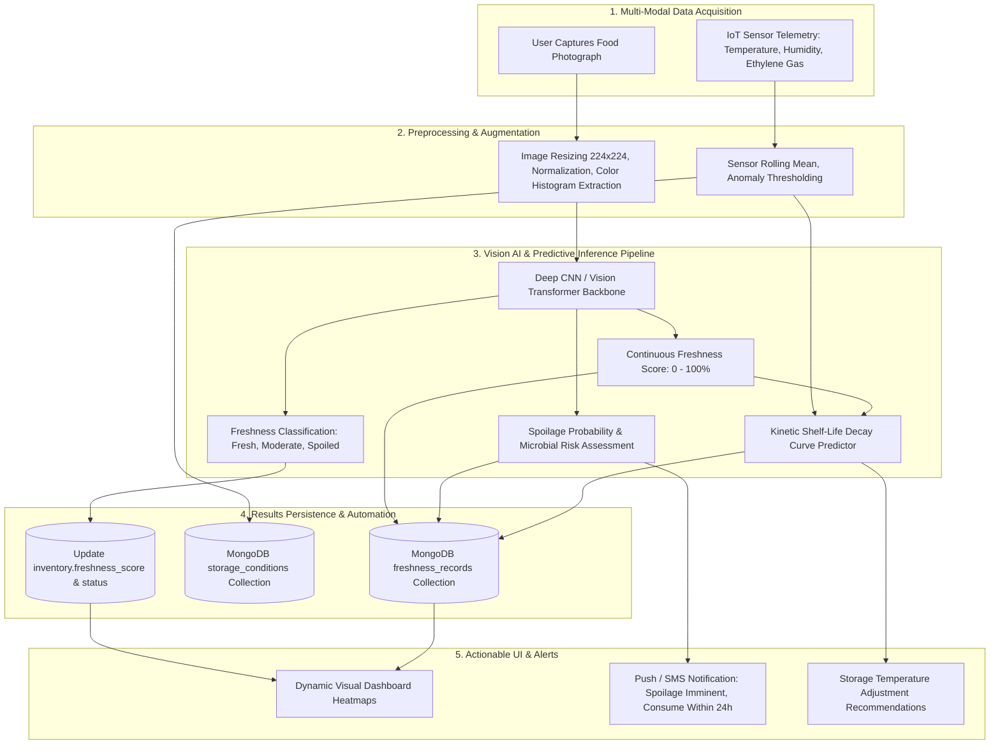

# Workflow Documentation

## Food Freshness Monitoring Platform — Workflows

---

### 1. Milestone 1 Implemented Workflow

The operational flow implemented and validated in **Milestone 1** handles user onboarding, role enforcement, and food inventory lifecycle management:

#### Detailed Steps:
1. **User Registration / Authentication**:
   - User submits Full Name, Email, Password, and Role (Consumer, Retailer, Restaurant, Warehouse Manager, etc.).
   - Password is confirmed and securely hashed with `bcrypt`.
   - On login, a signed JWT token is issued containing user ID, email, and role.
2. **Dashboard Initialization**:
   - The frontend issues an authenticated request to `GET /api/dashboard/stats`.
   - Real-time aggregation calculates totals, items nearing expiration (< 3 days), unanalyzed items, and storage anomalies.
3. **Food Inventory Intake**:
   - User inputs food details (name, category, quantity, unit, purchase/expiry dates, storage type, temperature, humidity, location, batch number, optional photo).
   - System validates that expiry date is not earlier than purchase date and quantity is positive.
   - Record is stored with initial `freshness_status = "Not Analyzed"`.
4. **Food Inspection & Maintenance**:
   - Users can search by name/batch, filter by category or expiry status, sort by dates, edit records, or delete items.

---

### 2. Future AI & IoT Workflow (Milestones 2 & 3)

The project architecture has been specifically decoupled so the upcoming AI and IoT pipelines can plug in without rewriting the existing database or frontend foundations:

#### Planned Capabilities:
1. **AI Freshness Scoring**: Convolutional neural networks will assign a 0–100% quality score based on surface discoloration, bruising, and texture indicators.
2. **Spoilage Early Warning**: Fusion of ethylene gas sensors and computer vision will identify rotting before visible surface mold appears.
3. **Dynamic Shelf-Life Decay Curves**: Machine learning regressors will model remaining shelf life as a dynamic function of actual ambient storage temperature and humidity history.
4. **Automated Preservation Recommendations**: The system will recommend moving items between pantry, refrigeration, or freezer to maximize lifespan.
